# Entra ID Identity Governance Lab

A hands-on Microsoft Entra ID lab: PowerShell/Microsoft Graph automation for the joiner/mover/leaver lifecycle, Zero Trust Conditional Access, Privileged Identity Management, access reviews, SAML SSO, and audit scripts.

## Lab environment
- Tenant: trial tenant (Office 365 E5 trial + Microsoft Entra ID P2 trial)
- 50 users across 5 department groups (Sales, Finance, Warehouse, IT, HR)
- Group-based licensing: Sales and Finance licensed; Warehouse unlicensed by design (25-seat trial)
- Tools: PowerShell 7, Microsoft Graph PowerShell SDK, Entra admin center

> Note: Office 365 E5 does not include Entra ID P1/P2, so a separate Entra ID P2 trial was added for Conditional Access, PIM and access reviews.

---

## Day 1 – Joiner / Mover / Leaver automation
Three PowerShell scripts using Microsoft Graph: joiner.ps1 creates users from a CSV (UsageLocation from the Country column, defaulting to CA), adds them to department groups and sets managers in a second pass; mover.ps1 changes department, manager and groups; leaver.ps1 disables the account, revokes sessions and removes group memberships.

**Group-based licensing after a Mover:** Tyler moved from Warehouse (unlicensed) to Sales and inherited E5 from grp-sales automatically, with no direct assignment.

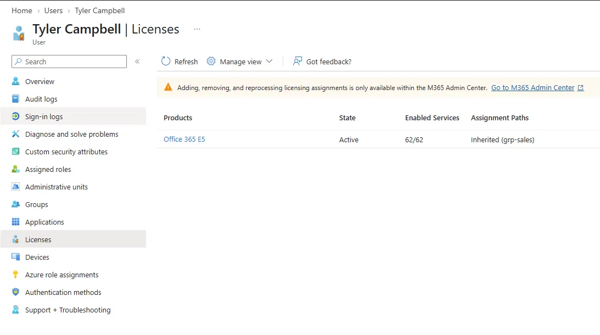

**Leaver:** account disabled, removed from all groups, and license freed.

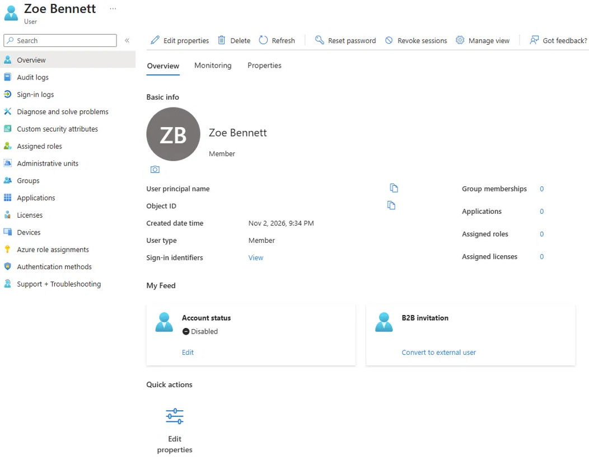

**Session revoke:** sessions revoked; the user's Outlook session was rejected (HTTP 440) at 03:09 UTC, consistent with Continuous Access Evaluation.

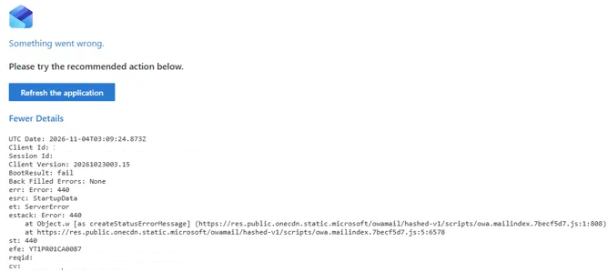

---

## Day 2 – Zero Trust security floor
**Conditional Access baseline:** MFA for all users, legacy authentication blocked, and a test policy in Report-only.

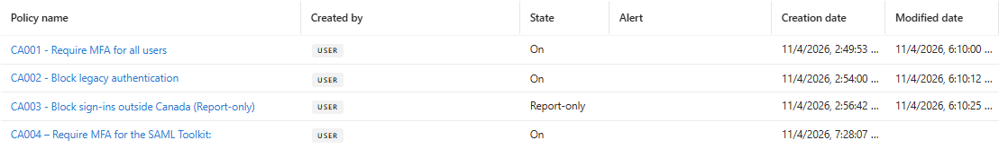

**Break-glass account excluded from MFA**, so an MFA or Conditional Access misconfiguration can't lock out all admins.

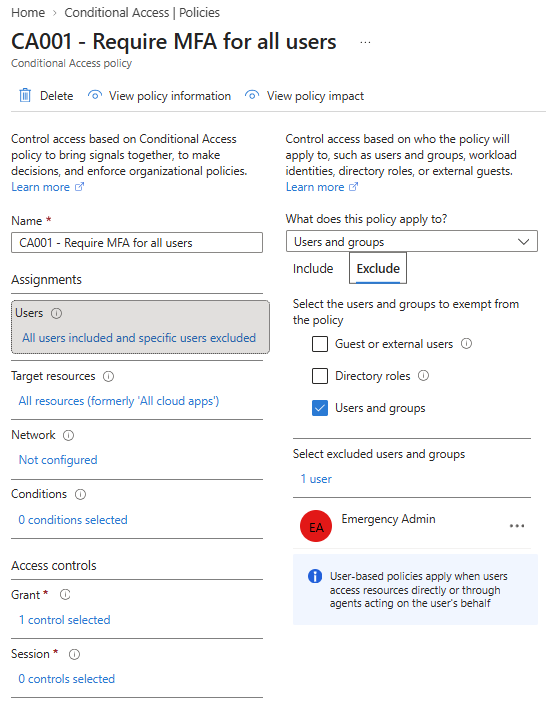

**Legacy auth blocked** (Exchange ActiveSync and other legacy clients).

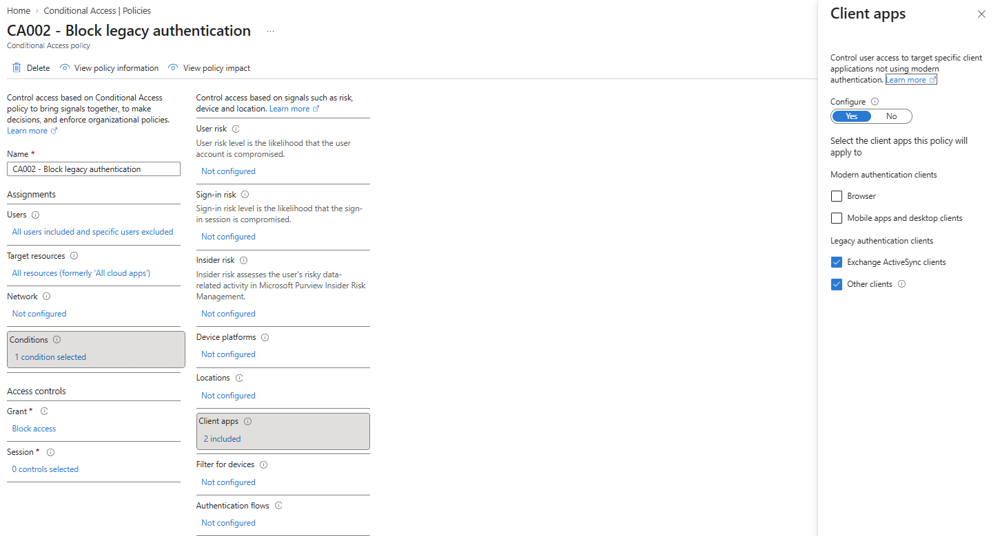

**PIM – User Administrator:** eligible, not permanent. Activation requires MFA, justification and approval, with a 4-hour maximum.

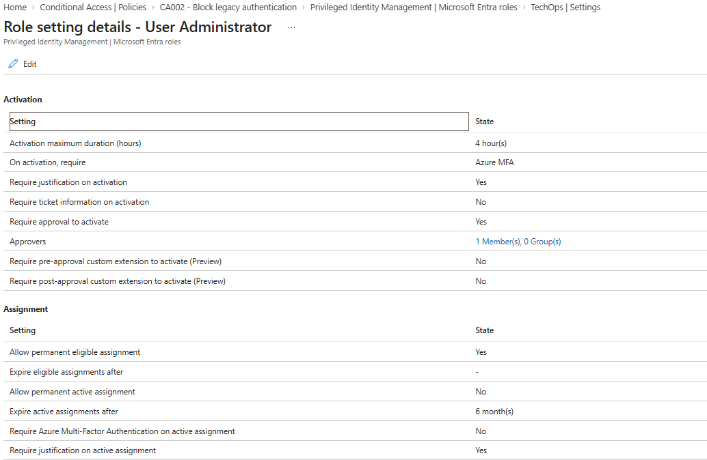

**Quarterly access review** on grp-priv-ops.

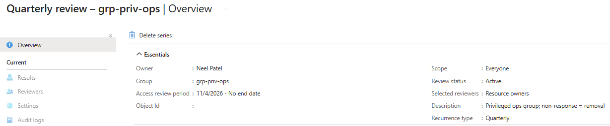

**SAML SSO app** with assignment required, plus a Conditional Access policy scoped only to that app requiring MFA.

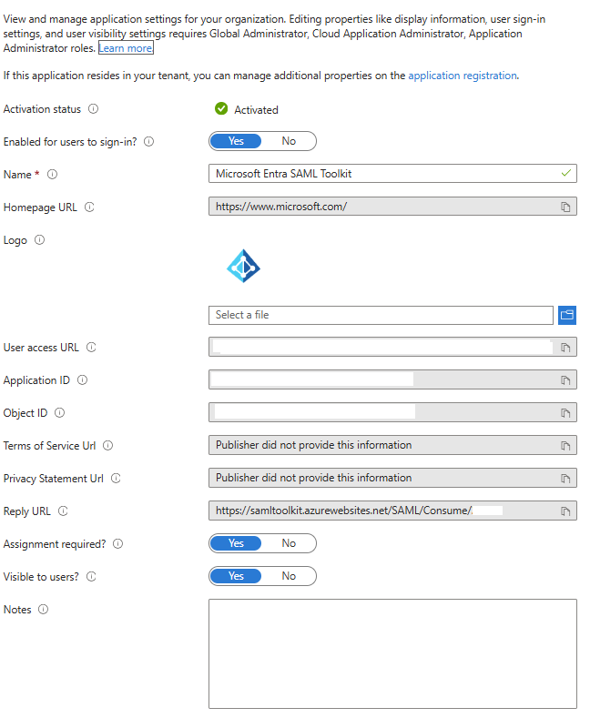

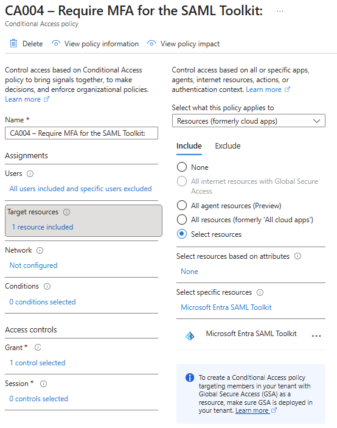

---

## Day 3 – Auditing & telemetry

### Incident simulation: smart lockout
Failed a test user's sign-in with a different wrong password each attempt (Entra ignores repeats of the same bad password). The account locked on attempt 12.

### investigate-signins.ps1
Pulls failed sign-ins from the **sign-in logs** (`Get-MgAuditLogSignIn`, not the directory audit logs) using a server-side Graph filter, translates error codes, converts UTC to local time, and checks for password-spray patterns (one IP failing against 3+ users).

**Result:** 11 × **50126** (wrong password) between 4:52:00 and 4:52:37 PM, then **50053** (locked by smart lockout) at 4:52:41 PM. All from one IP, so a targeted attempt, not a password spray.

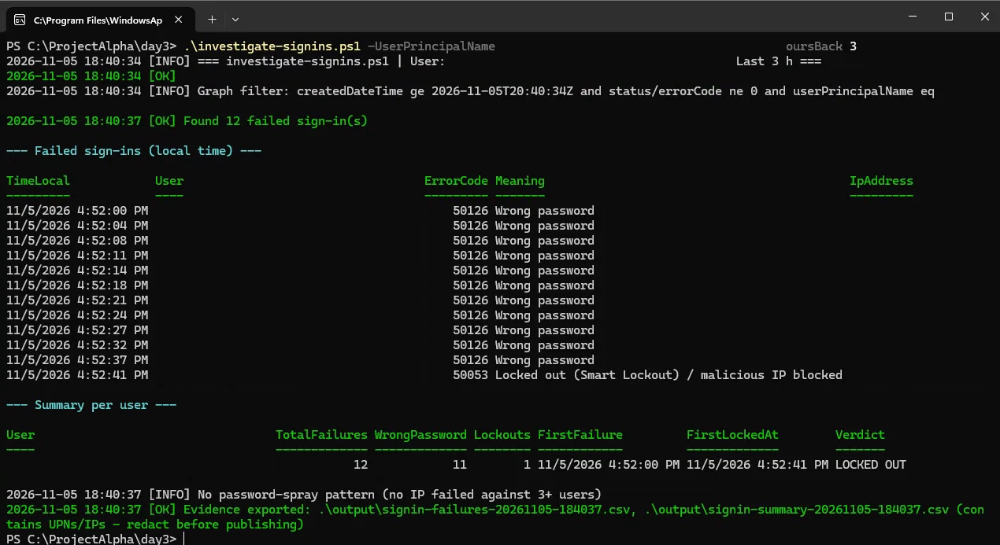

### ca-audit.ps1
Exports every Conditional Access policy and checks the security floor: MFA for all users, legacy auth blocked, break-glass excluded, and any policy left in Report-only.

**Result:** all floor checks passed; break-glass excluded from every all-users policy; CA003 flagged as **Report-only (logged but not enforced)**.

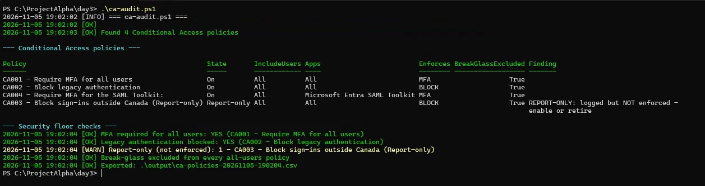

### identity-governance-audit.ps1
Separates **standing** admin assignments from **PIM-eligible** ones (using role assignment and eligibility schedule instances), and flags inactive users, treating never-signed-in accounts (null `LastSignInDateTime`) as their own category instead of crashing or miscounting them.

**Result:** one standing Global Admin flagged for conversion to PIM, the break-glass account recognized as permanent by design, and Ops Admin confirmed **eligible, not active** for User Administrator, which proves the Day 2 PIM setup. Users: 46 never signed in, 4 active, 2 disabled.

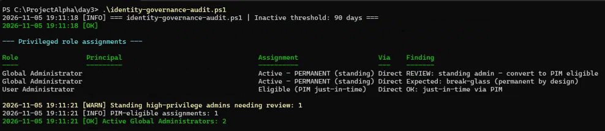

## Repository structure
- `scripts/` – joiner.ps1, mover.ps1, leaver.ps1, investigate-signins.ps1, identity-governance-audit.ps1, ca-audit.ps1, new-hires.csv (placeholder domain)
- `Day1/`, `Day2/`, `Day3/` – redacted evidence screenshots

## How to run
Requires PowerShell 7 and the Microsoft Graph PowerShell SDK:

```powershell
Install-Module Microsoft.Graph -Scope CurrentUser
```

Set your own domain in `joiner.ps1` (`$Domain`), `mover.ps1`/`leaver.ps1` (target UPNs) and the `-BreakGlassUpns` default in the audit scripts, then:

```powershell
cd scripts
.\joiner.ps1                                            # create users from new-hires.csv
.\mover.ps1                                             # move one user to a new department
.\leaver.ps1                                            # disable, revoke sessions, strip groups
.\investigate-signins.ps1 -UserPrincipalName <upn> -HoursBack 3
.\identity-governance-audit.ps1                         # standing admins + inactive users
.\ca-audit.ps1                                          # Conditional Access security floor
```

The audit scripts are read-only. Outputs go to `.\output\` (excluded by .gitignore).

---

## Challenges & fixes
- **Scripts reported "success" on failures:** errors were silently ignored, so the log said success while nothing changed → added `-ErrorAction Stop` with try/catch.
- **WAM sign-in failure on new Graph scopes** ("window handle must be configured") → reused already-consented scopes; standardized on PowerShell 7 (scripts were accidentally being run in Windows PowerShell 5.1).
- **License assignment moved:** the Entra portal can no longer assign group licenses → assigned through the M365 admin center.
- **Disabled users still consuming licenses:** a disabled account keeps its group membership and therefore its license. Spotted on Day 1, then caught automatically by `identity-governance-audit.ps1` on Day 3 → removed from the group, and the re-audit came back clean. The leaver process now strips group memberships.
- **PIM pending request not where expected:** after activation was requested, the role still showed under Eligible → the request lives under My requests. Approved it from a second session, and the role activated with a 4-hour end time.
- **Smart lockout didn't trigger at first:** Entra ignores repeats of the same wrong password → used a different wrong password each attempt; locked on attempt 12 (11 × 50126, then 50053).
- **False finding in `ca-audit.ps1`:** Graph returns an empty AuthenticationStrength object instead of null, so every policy looked like it had one → fixed by checking the object's Id.

## Security notes
- All tenant names, object IDs and UPNs are redacted.
- Script outputs containing temporary passwords are excluded via .gitignore.
- Lab ran in a trial tenant; no production data.
- Break-glass account name and tenant domain replaced with placeholders in all scripts.
- No hardcoded passwords: joiner.ps1 generates a random temporary password at runtime.
